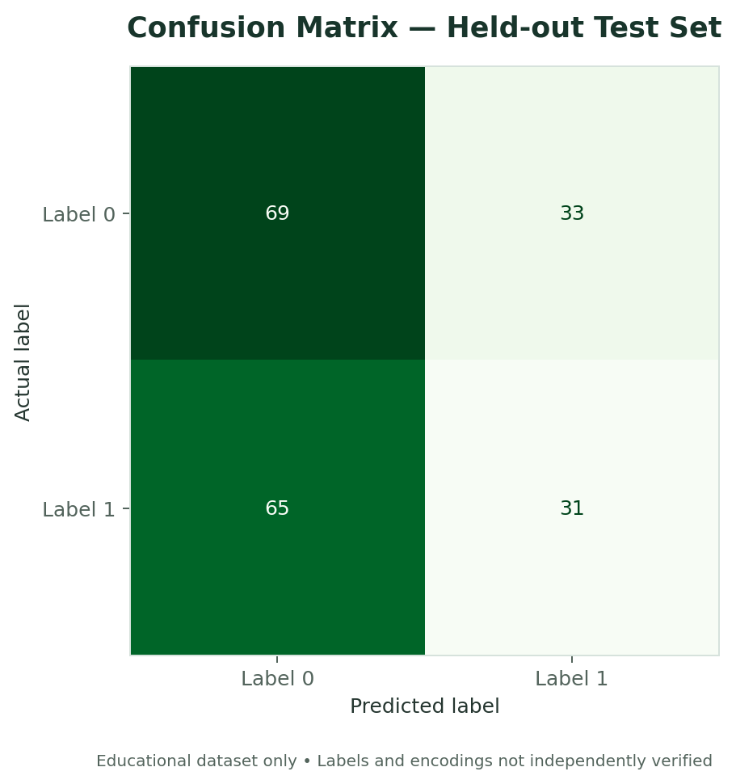
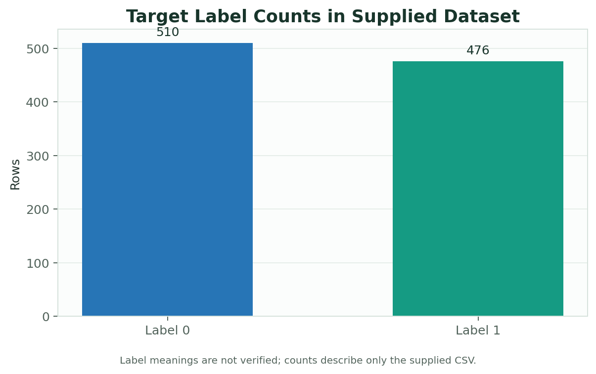

# COVID-19 Label Classification — Educational Example

A beginner-level machine learning exercise using **Logistic Regression** to classify the binary target column supplied in `covid.csv`.

> **Important:** This is an educational exercise only. It is not a medical device or diagnostic tool and must not be used for diagnosis, screening, or healthcare decisions. The dataset source, label definitions, and collection methodology were not included with the supplied files.

## What this project covers
- Inspecting a CSV and checking missing values
- Separating features from the target label
- Reproducible stratified train/test splitting
- Scaling numeric features in a scikit-learn pipeline
- Training Logistic Regression
- Evaluating with accuracy, precision, recall, F1-score, and a confusion matrix

## Project structure
```text
covid-19-classification/
├── covid_classification.ipynb
├── covid.csv
├── README.md
└── requirements.txt
```

## Run locally
```bash
python -m venv .venv
# Windows PowerShell:
.venv\\Scripts\\Activate.ps1
# macOS/Linux:
# source .venv/bin/activate

python -m pip install -r requirements.txt
jupyter notebook
```
Open `covid_classification.ipynb` and run all cells from top to bottom.

## Dataset fields
- `Age`
- `Gender`
- `Fever`
- `Cough`
- `Has_Covid` (binary values encoded as 0/1 in the supplied file)

The meaning of the encodings and the units must be verified from the original dataset documentation before interpretation. The notebook drops rows with missing values for a simple baseline and reports the number of rows removed.

## Visual results

The following figure is generated from the notebook's fixed held-out test split. It describes performance on this supplied dataset only; it is **not** evidence of medical validity.



Target-label counts in the supplied CSV (label meanings are unverified):



## Evaluation
The notebook reports several metrics and a confusion matrix for one held-out test split. Performance on this dataset does not establish generalization or medical validity.

## Before publishing
1. Verify the dataset's original source and license.
2. Document the meaning of target labels and feature encodings/units.
3. Confirm that redistribution is permitted.
4. Re-run the notebook from top to bottom in a clean environment.

## License
No license has been added. Do not add a license or redistribute data until the relevant rights are confirmed.
